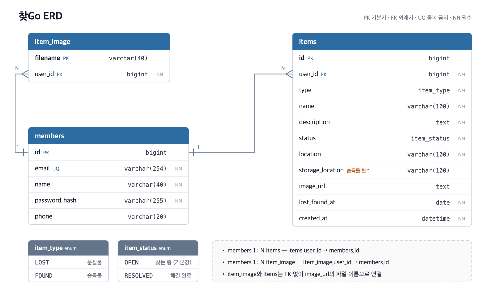

# ERD와 데이터 모델

> **📖 작성 가이드**
>
> **이 문서의 목적**
>
> 저장할 데이터를 표로 나누고, 표 사이의 관계를 정리합니다.

---

## 1. 저장할 데이터 찾기

**ERD**는 데이터베이스의 구조를 보여주는 그림입니다. 기능 목록과 API를 보면서 나중에 다시 조회해야 하는 정보부터 찾습니다.

한 표에는 한 종류의 데이터를 모읍니다. 표마다 **존재 이유**, **주요 필드**, **다른 표와의 관계**를 적습니다. 화면에서만 잠시 쓰는 값까지 모두 저장할 필요는 없습니다.

| 테이블명 | 의미 | 주요 필드 | 존재 이유 | 다른 표와의 관계 |
| --- | --- | --- | --- | --- |
| **members** | 회원 저장 | id, email, name, password_hash, phone | 로그인하고 게시물 작성자를 구분하기 위해. phone은 물품 상세에서 작성자 연락처로도 쓴다 | 물품과 사진을 여러 개 가진다 |
| **items** | 물품 저장 | id, user_id, type, name, description, status, location, storage_location, image_url, lost_found_at, created_at | 분실물·습득물을 한곳에 모아 목록·검색·상세 조회에 쓰기 위해 | 회원 1명에게 속하고, image_url로 사진을 0~1장 가리킨다 |
| **item_image** | 사진 업로드 기록 저장 | filename, user_id | 사진을 올린 사람을 기록해, 본인이 올린 사진만 물품에 첨부하게 하기 위해 | 회원 1명에게 속한다. 물품과는 FK 없이 items.image_url의 파일 이름으로 연결된다 |

소유 확인과 물건 전달은 서비스 밖(보관 장소, 또는 작성자와 연락)에서 이루어지므로 따로 표를 두지 않습니다. 서비스는 그 결과로 바뀐 `items.status`만 저장합니다. 물품 종류는 첫 버전에서 제외해 칸을 만들지 않습니다.

---

## 2. 관계를 표현하는 기본 개념

### ERD

dbdiagram.io에서 그림을 고치려면 [images/erd.dbml](images/erd.dbml)의 코드를 붙여 넣습니다.

### 관계

|  | 필드 | PK | FK | 관계 |
| --- | --- | --- | --- | --- |
| **members** | id, email, name, password_hash, phone | **id** : 회원 번호 | X | • **members 1 : N items** : 회원 1명은 물품을 여러 개 등록할 수 있다 • **members 1 : N item_image** : 회원 1명은 사진을 여러 장 올릴 수 있다 |
| **items** | id, user_id, type, name, description, status, location, storage_location, image_url, lost_found_at, created_at | **id** : 물품 번호 | user_id → members.id | • **members 1 : N items** : 물품 1개는 작성자 1명에게만 속한다 • 물품 1개는 image_url에 사진 주소를 1개까지 저장하고, 사진 없이도 등록할 수 있다 (item_image와 FK로 잇지 않음) |
| **item_image** | filename, user_id | **filename** : 사진 파일 이름 | user_id → members.id | • **members 1 : N item_image** : 사진 1장은 올린 회원 1명에게만 속한다 |

---

## 3. 제약과 변경 규칙

중복되면 안 되는 값, 반드시 있어야 하는 값, 데이터가 삭제될 때 연결된 데이터가 어떻게 되는지 정합니다. 데이터 이름과 자료형이 API의 요청·응답과 맞는지도 확인합니다.

처음부터 모든 필드를 그리기보다 핵심 기능에 필요한 표와 관계부터 완성합니다.

> **핵심:** ERD는 보기 좋은 그림을 만드는 작업이 아니라, 데이터를 저장하고 다시 찾는 규칙을 합의하는 작업입니다.

| 테이블 | 중복 금지 (UNIQUE) | 필수 값 (NOT NULL) | 선택 값 | 값 규칙 | 삭제·변경 규칙 | API 이름 (DB → API) |
| --- | --- | --- | --- | --- | --- | --- |
| members | email | email, name, password_hash | phone | • email은 소문자로 저장 • 비밀번호 8자 이상, 암호화해서 저장 • phone은 010-0000-0000 형식 • phone이 없으면 화면에 표시하지 않음 | X | password_hash → password (요청에만 사용, 응답에 미포함) • name → userName, phone → userPhone (물품 상세의 작성자 정보, 토큰 없으면 userPhone은 null) |
| items | 없음 | user_id, type, name, description, status, location, lost_found_at, created_at | storage_location, image_url | • type은 LOST, FOUND만 • status는 OPEN, RESOLVED만 (default = OPEN) • name·location 100자, description 2000자 이하 • storage_location은 습득물만 저장. 분실물과 같은 테이블이라 NULL을 허용하고, 습득물일 때 필수인지는 화면과 백엔드가 검사 • lost_found_at은 분실·습득 날짜, 미래 날짜 불가, 정렬에 쓰지 않음 • created_at은 등록 일시, 목록 정렬 기준 | • 수정·삭제·상태 변경은 작성자만 • 수정해도 id, user_id, created_at은 그대로 • 상태 변경은 행을 지우지 않고 status만 바꿈 (물건 전달 뒤 작성자가 RESOLVED로 변경) • 같은 물건의 분실물 글과 습득물 글은 연결하지 않음 • 소유 확인·물건 전달 기록은 저장하지 않음 • 삭제하거나 image_url을 바꾸면 예전 사진 파일과 item_image 기록을 백엔드가 함께 삭제 | user_id → userId • storage_location → storageLocation • image_url → imageUrl • lost_found_at → lostFoundAt (YYYY-MM-DD) • created_at → createdAt |
| item_image | filename | filename, user_id | 없음 | • JPG·PNG만, 5MB 이하 • 본인이 올린 사진만 물품에 첨부 가능 (image_url의 파일 이름으로 찾아 user_id 비교) • 물품 1개당 사진 1장까지 | • 물품이 삭제되거나 사진이 바뀌면 예전 사진 기록과 파일을 삭제 • 어떤 물품의 image_url에도 연결되지 않은 사진은 업로드 3시간 뒤 자동 삭제 | 직접 주고받지 않음. 업로드 응답의 imageUrl로만 사용 |

※ 3시간을 세려면 업로드 시각이 필요합니다. item_image에 업로드 시각 칸을 둘지, 서버에 저장된 파일의 시각을 쓸지 백엔드에서 정해야 합니다.

### ✅ 작성 완료 확인

- [ ] 각 표의 존재 이유가 설명됩니다.
- [ ] PK와 필요한 FK가 표시됩니다.
- [ ] 관계와 제약이 기능·API와 일치합니다.
