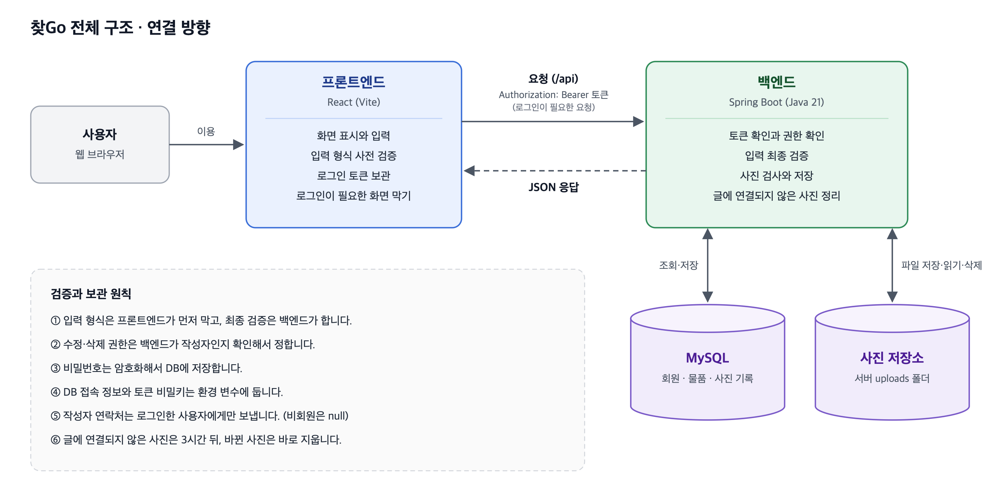

# 기술 스택과 전체 구조

> **📖 작성 가이드**
>
> **이 문서의 목적**
>
> 서비스에 필요한 기술을 선택하고, 각 기술이 맡는 역할과 연결 방식을 설명합니다.
>
> **1. 필요한 구성 요소 파악하기**
>
> 기술 이름을 먼저 정하지 않습니다. 사용자 화면, 서버 처리, 데이터 저장처럼 **서비스가 해야 할 일**을 먼저 나눕니다.
>
> - **프론트엔드:** 화면 표시, 입력, 로딩과 오류 상태
> - **백엔드:** 요청 처리, 규칙 검증, 데이터 조회와 저장
> - **DB:** 이후에도 유지해야 하는 데이터 보관
> - **외부 서비스:** 직접 구현하지 않는 기능이 필요한 경우에만 추가
>
> 구성 요소가 늘어날수록 개발과 운영의 부담도 커집니다. 각 요소가 없을 때 어떤 기능을 구현할 수 없는지 확인합니다.
>
> **2. 기술 선택 기준**
>
> | 확인할 기준 | 판단할 내용 |
> | --- | --- |
> | 기능 적합성 | 필요한 기능을 구현할 수 있는가 |
> | 팀 역량 | 팀원이 이해하고 수정할 수 있는가 |
> | 연결 방식 | 다른 구성 요소와 데이터를 주고받을 수 있는가 |
> | 운영 부담 | 배포, 비용, 오류 확인이 가능한가 |
>
> 선택한 기술마다 **담당할 일과 선택 이유**를 함께 기록합니다.
>
> **3. 전체 구조 그리기**
>
> 사용자 행동이 화면에서 시작해 서버와 DB를 거쳐 결과로 돌아오는 방향을 표시합니다. 어느 부분이 최종 검증을 맡는지와 민감한 정보를 어디에 보관하는지도 정합니다.
>
> **핵심:** 기술의 수보다 각 부분의 책임과 연결 방향이 명확한지가 중요합니다.

---

## 1. 필요한 구성 요소 파악하기

기술 이름을 먼저 정하지 않습니다. 사용자 화면, 서버 처리, 데이터 저장처럼 **서비스가 해야 할 일**을 먼저 나눕니다.

- **프론트엔드**
  - **화면 표시** : 물품 목록(첫 화면), 상세, 등록·수정, 검색, 마이페이지, 로그인·회원가입 화면을 보여 준다
  - **입력 받기** : 회원 정보, 물품 정보, 사진, 검색어와 조건을 입력받는다
  - **입력 확인** : 필수 항목이나 글자 수처럼 간단한 규칙은 서버로 보내기 전에 먼저 알려 준다
  - **로딩 상태** : 목록을 불러오거나 사진을 올리는 동안 로딩 표시를 하고, 버튼이 두 번 눌리지 않게 막는다
  - **오류 상태** : 서버가 보낸 오류 메시지를 화면에 보여 주고, 결과가 없을 때 빈 화면 안내를 띄운다
  - **화면 권한 처리** : 로그인하지 않았으면 등록 버튼을 누를 때 로그인 화면으로 보내고, 작성자에게만 수정·삭제 버튼을 보여 준다. 비회원에게는 작성자 연락처 대신 로그인 안내를 보여 준다
  - **보관 장소 칸 처리** : 습득물일 때만 보관 장소 칸을 보여 주고 필수로 검사한다. 분실물이면 칸을 숨기고 값을 보내지 않으며, 상세 화면에도 보관 장소를 표시하지 않는다
  - **빈 값 표시** : 값이 없는 선택 항목(보관 장소, 전화번호, 작성자 연락처)은 칸을 표시하지 않고, 사진이 없으면 기본 이미지를 보여 준다
- **백엔드**
  - **요청 처리** : 화면에서 온 등록, 조회, 검색, 수정, 삭제 요청을 받아 처리한다
  - **로그인 관리** : 비밀번호를 확인해 JWT 토큰을 발급하고, 요청마다 토큰을 확인한다. 로그인 상태를 서버에 따로 보관하지 않는다
  - **규칙 검증**
    - 이메일 중복, 필수 항목(습득물이면 보관 장소 포함), 글자 수, 미래 날짜를 검사한다
    - 작성자만 수정·삭제·상태 변경을 할 수 있게 한다
    - 사진의 형식과 용량을 검사하고, 본인이 올린 사진만 첨부하게 한다
  - **데이터 조회와 저장** : 검색 조건에 맞는 물품을 찾아 등록 일시(createdAt) 기준으로 정렬하고, 결과를 20개씩 나눠 보낸다. 물품 상세에는 작성자 이름과 연락처를 넣되, 토큰이 없으면 연락처를 null로 보낸다
  - **사진 처리** : 업로드된 사진의 크기를 줄여 저장하고, 요청이 오면 보여 준다. 물품을 삭제하거나 사진을 바꾸면 예전 사진 파일을 지우고, 글에 연결되지 않은 사진은 3시간 뒤 지운다
- **DB**
  - 회원 정보, 물품 정보, 사진 업로드 기록처럼 **서버를 껐다 켜도 남아 있어야 하는 데이터**를 보관한다
  - 이메일 중복 금지, 필수 값 같은 제약을 지킨다

---

## 2. 기술 선택

| 구분 | 기술 | 담당할 일 | 선택 이유 |
| --- | --- | --- | --- |
| 프론트엔드 | React 18 | 화면 구성, 입력, 로딩·오류 상태 | 카드·입력 칸 같은 화면 조각을 재사용할 수 있고, 팀원이 수업에서 다룬 기술입니다. |
|  | React Router | 화면 이동, 로그인이 필요한 화면 보호 | 주소마다 화면을 나누고, 로그인하지 않은 사용자를 로그인 화면으로 보낼 수 있습니다. |
|  | Vite | 개발 서버, 배포용 빌드 | 설정이 적고 실행이 빠릅니다. |
|  | Axios | 백엔드 API 요청 | 모든 요청에 토큰을 붙이는 공통 설정과 만료 처리를 한 곳에서 관리할 수 있습니다. |
| 백엔드 | Spring Boot 4.1 (Java 21) | API 서버 | 팀원이 수업에서 다룬 기술이고, 보안·DB 연결 기능을 함께 제공합니다. |
|  | Spring Security | 요청마다 토큰 확인, 비밀번호 암호화(PBKDF2), 권한 확인 | 로그인과 보안 기능을 직접 만들지 않고 검증된 방식으로 처리합니다. |
|  | JWT | 로그인 토큰 발급과 검증 | 서버가 로그인 상태를 따로 보관하지 않아도 되고, 프론트엔드와 백엔드 주소가 달라도 요청 헤더로 토큰을 전달할 수 있습니다. |
|  | Spring Data JPA | DB 조회와 저장 | SQL을 직접 쓰지 않고 객체(Entity)로 데이터를 다룹니다. |
|  | Bean Validation | 입력 규칙 검증 (필수값, 길이, 날짜) | 규칙을 필드에 붙여 한 곳에서 관리합니다. |
|  | Swagger (springdoc) | API 문서 | 프론트엔드 팀원이 API 주소와 요청 형식을 화면에서 확인하고 직접 호출해 볼 수 있습니다. |
| DB | MySQL | 회원·물품·사진 정보 보관 | 회원과 물품처럼 관계가 있는 데이터에 맞고, 팀원이 수업에서 다룬 DB입니다. |
| 테스트 | JUnit + H2 | 인증·권한·검색·사진 처리 확인 | 실제 MySQL 데이터를 건드리지 않고 테스트합니다. |
| 개발 환경 | 로컬 실행 | 프론트엔드(Vite 개발 서버), 백엔드(Spring Boot), MySQL을 각자 컴퓨터에서 실행 | 프로토타입 단계에서는 서버 비용과 배포 설정 없이 기능 개발에 집중합니다. |

---

## 3. 전체 구조

### 연결 방향

### 요청 예시: 물품 등록

1. **프론트엔드**: 필수 항목(습득물이면 보관 장소 포함), 날짜, 글자 수, 사진 형식을 먼저 확인합니다. 틀린 곳이 있으면 요청을 보내지 않고 바로 안내합니다.
2. **프론트엔드 → 백엔드**: 사진이 있으면 먼저 사진을 올리고(`POST /api/images`), 돌려받은 사진 주소를 물품 정보에 넣어 등록을 요청합니다(`POST /api/items`).
3. **백엔드**: 토큰 확인 → 입력 규칙 검증 → 본인이 올린 사진인지 확인 → 작성자를 로그인한 사용자로 지정합니다.
4. **백엔드 → DB**: 물품을 저장합니다.
5. **백엔드 → 프론트엔드**: 저장한 물품 정보를 돌려주면, 프론트엔드가 등록한 물품의 상세 화면을 보여줍니다.

### 검증과 데이터 책임

검증은 두 번 합니다.

- **프론트엔드 사전 검증:** 이메일 형식, 비밀번호 길이처럼 입력값만 보고 판단할 수 있는 규칙은 프론트엔드가 먼저 막습니다. 잘못된 요청을 서버에 보내지 않으므로 사용자는 바로 안내를 받고, 서버 요청도 줄어듭니다.
- **백엔드 최종 검증:** 화면을 거치지 않고 API를 직접 호출하면 프론트엔드 검사를 건너뛸 수 있으므로, 백엔드가 같은 규칙을 한 번 더 검사합니다. 이메일 중복, 작성자 확인처럼 DB를 봐야 알 수 있는 검사는 백엔드만 할 수 있습니다.

| 데이터 | 만드는 곳 | 프론트엔드 사전 검증 | 백엔드 최종 검증 | 보관 위치 |
| --- | --- | --- | --- | --- |
| 회원 (이메일, 이름, 전화번호) | 회원가입 화면 | 빈 칸, 이메일 형식, 이름 1~40자, 전화번호 형식(입력했을 때) | 같은 규칙 + **이메일 중복** | DB |
| 비밀번호 | 회원가입 화면 | 8~64자, 비밀번호 확인과 일치 | 8~64자, 암호화(PBKDF2)해서 저장, 응답에 넣지 않음 | DB (암호화된 값만) |
| 로그인 토큰 (JWT) | 백엔드 (로그인 성공 시 발급) | 토큰이 없으면 로그인이 필요한 화면 대신 로그인 화면으로 보냄 | 요청마다 **서명과 만료 시간** 확인, 잘못되거나 만료되면 거절(401) | 브라우저 저장소 (로그아웃 시 삭제) |
| 물품 | 등록·수정 화면 | 유형·이름·설명·장소·날짜 필수, 습득물이면 보관 장소 필수, 미래 날짜 선택 막기, 글자 수 제한 | 같은 규칙 (습득물일 때만 보관 장소 필수) | DB |
| 물품 번호, 작성자, 등록 일시 | 백엔드 | - (프론트엔드가 보내지 않음) | 백엔드가 직접 정함 | DB |
| 물품 상태 (찾는 중·해결 완료) | 백엔드 (등록 시 OPEN), 수정 화면 (작성자가 변경) | 작성자에게만 상태 선택을 보여 줌 | 작성자인지, OPEN/RESOLVED 값인지 확인 | DB |
| 수정·삭제·상태 변경 권한 | - | 작성자가 아니면 버튼을 숨김 | **작성자가 아니면 거절(403)** | - |
| 작성자 연락처 | 회원가입 때 입력한 전화번호 | 비회원이면 연락처 대신 로그인 안내, 전화번호가 없으면 칸 숨김 | 토큰이 없으면 **연락처를 null로 보냄** | DB (members.phone) |
| 소유 확인·물건 전달 | 서비스 밖 (보관 장소, 또는 작성자와 연락) | - | - | 저장하지 않음 |
| 사진 파일 | 등록·수정 화면 | JPG/PNG만 선택, 5MB 이하 | 같은 규칙 + **실제 이미지인지·해상도 확인**, 올린 사람만 첨부 가능, 글에 연결되지 않은 사진은 3시간 뒤 삭제 | 서버 사진 저장소 |
| DB 접속 정보, 토큰 서명 비밀키 | 운영자 | - | - | 환경 변수 (코드·GitHub에 넣지 않음) |

굵게 표시한 항목은 DB나 서버만 아는 정보가 필요해서 백엔드만 검사할 수 있습니다.

### 프론트엔드와 백엔드의 연결 약속

| 항목 | 약속 |
| --- | --- |
| API 주소 | 모든 API는 `/api` 아래에 둡니다. 프론트엔드는 환경 변수(`VITE_API_BASE_URL`)로 백엔드 주소를 정하고, 백엔드는 프론트엔드 주소를 CORS 허용 목록에 등록합니다. |
| 인증 | **JWT 토큰**을 사용합니다. 로그인이 필요한 요청에는 `Authorization: Bearer 토큰` 헤더를 넣습니다. 쿠키를 쓰지 않으므로 CSRF 토큰은 사용하지 않습니다. |
| 로그인 | `POST /api/auth/login`에 JSON(`email`, `password`)으로 보내고, 응답으로 `accessToken`과 사용자 정보(`id`, `name`, `email`)를 받습니다. |
| 로그아웃·만료 | 로그아웃하면 프론트엔드가 저장한 토큰을 지우고 물품 목록으로 이동합니다. 만료된 토큰으로 요청하면 백엔드가 401로 응답하고, 프론트엔드는 토큰을 지운 뒤 로그인 화면으로 보냅니다. |
| 입력 규칙 | 이메일 형식, 비밀번호 8~64자, 이름 1~40자, 전화번호 `010-0000-0000` 형식, 글자 수 제한, 사진 형식·크기는 프론트엔드와 백엔드가 **같은 값**을 씁니다. 값이 다르면 화면에서는 통과했는데 서버에서 거절되는 일이 생깁니다. |
| 목록 정렬 | 등록 일시(`createdAt`) 기준입니다. 기본은 최신순이고, 분실·습득 날짜(`lostFoundAt`)는 정렬에 쓰지 않습니다. 미해결 물품만 보려면 상태 필터(`status=OPEN`)를 씁니다. |
| 보관 장소 | 습득물(`FOUND`)일 때만 화면에서 받고 필수입니다. 백엔드도 습득물일 때만 필수로 검사합니다. 분실물(`LOST`)은 `storageLocation`을 보내지 않습니다. |
| 작성자 연락처 | 물품 상세 응답에 `userName`, `userPhone`을 넣습니다. 토큰이 없으면 `userPhone`은 `null`입니다. |
| 물품 상태 | `OPEN`(찾는 중) / `RESOLVED`(해결 완료) 두 가지 값을 씁니다. `RESOLVED`는 물건이 전달된 뒤 작성자가 바꿉니다. |
| 작성자 확인 | 물품의 `userId`와 로그인한 사용자의 `id`가 같으면 수정·삭제 버튼을 보여줍니다. |
| 목록 응답 | 페이지 형식(`content`, `page`, `totalPages` 등)으로 받습니다. 내 물품은 `GET /api/me/items`입니다. |
| 사진 | JPG/PNG만 받습니다. 다른 형식은 프론트엔드에서 JPEG로 바꿔 보냅니다. 사진을 먼저 올려 받은 `imageUrl`을 물품 등록·수정 때 보내고, 글에 연결되지 않은 사진은 3시간 뒤 서버가 지웁니다. |
| 물품 종류 | 첫 버전에서 제외하고 후속 개선으로 옮겼습니다. 화면, DB, API에 넣지 않습니다. |

### 배포 때 다시 정할 것

배포는 프로토타입이 완성된 뒤 논의합니다. 그때 아래 항목을 정합니다.

| 항목 | 정할 내용 |
| --- | --- |
| 배포 서비스 | 프론트엔드, 백엔드, MySQL을 각각 어디에 올릴지, 비용은 얼마인지 |
| 사진 저장 위치 | 지금처럼 서버 폴더에 둘지, 외부 저장소(객체 스토리지)로 옮길지. 배포 서비스에 따라 서버 폴더는 다시 배포할 때 비워질 수 있습니다. |
| 주소 연결 | 배포한 백엔드 주소를 프론트엔드 환경 변수에, 프론트엔드 주소를 백엔드 CORS 허용 목록에 등록 |
| 환경 변수 | DB 접속 정보와 토큰 서명 비밀키를 배포 서비스에 등록. 비밀키를 바꾸면 모든 사용자의 로그인이 풀립니다. |

프로토타입 단계에서도 비밀번호와 토큰 비밀키는 코드에 쓰지 않고 환경 변수로 둡니다. GitHub에 한 번 올라간 값은 지워도 기록에 남기 때문입니다.

### ✅ 작성 완료 확인

- [ ] 각 기술의 역할과 선택 이유가 있습니다.
- [ ] 화면·서버·DB의 연결 방향이 보입니다.
- [x] 최종 검증과 민감 정보의 담당 위치가 정해져 있습니다.
